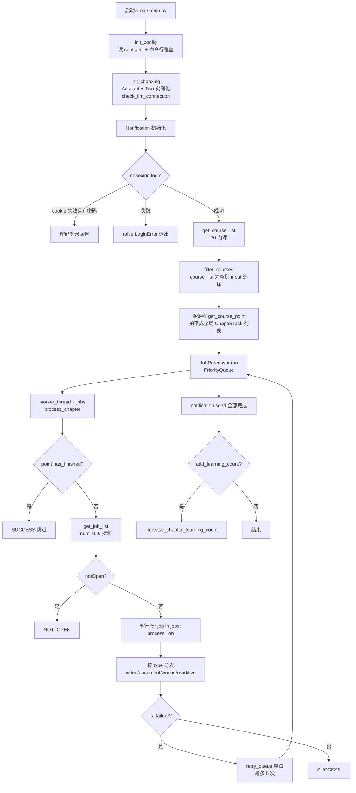

# chaoxing 完整链路流程

> 对应版本：`45d2106`（v3.1.4 之后）
> 代码路径均相对 `E:\My_Projects\chaoxing`
> 本文只讲"程序怎么跑"，使用方式见 [本地使用说明.md](本地使用说明.md)
> ⚠️ 本仓库有本地补丁（abc0d66）：filter_courses 重写（+20 行）、
eport_unfinished 新增、main() 起点由 550 变为 617、decode.py 加了讨论题告警。**文中行号按上游 45d2106 标注**，在本仓库里请优先用函数名搜索。

## 0. 一句话总览

`main.py` 只负责**准备和调度**；真正的动作全在 `api/base.py` 的 `Chaoxing` 类里；
`api/decode.py` 把页面 HTML 变成字典；`api/answer.py` 负责题库 / 大模型答题。

```
启动 → 读配置 → 登录 → 拉课程列表 → 选课 → 拍平所有章节 → 队列并发 → 单章节内串行跑任务点
                                                                          ├ video
                                                                          ├ document
                                                                          ├ workid（LLM 答题）
                                                                          ├ read
                                                                          └ live
                                                                     收尾 → 通知 →（可选）刷学习次数
```

## 1. 全局流程图



## 2. 阶段一：启动与配置（`main.py:550`）

`main()` 按顺序做六件事：

| 步骤 | 位置 | 说明 |
|---|---|---|
| 1. `init_config()` | `main.py:555` 附近 | 读 `config.ini`，命令行参数覆盖；`speed` 被强制夹在 `min(2.0, max(1.0, speed))`（`main.py:557`） |
| 2. `init_chaoxing()` | `main.py:225-244` | 建 `Chaoxing(Account, tiku)`；`Tiku.get_tiku_from_config()` 按 `[tiku] provider` 实例化；对 `AI`/`SiliconFlow` 跑一次 `check_llm_connection`（**会真打一次接口**） |
| 3. `Notification(...)` | — | ServerChan / Qmsg / Bark / Telegram，只用于发结果 |
| 4. `chaoxing.login()` | `main.py:574` | 失败直接 `raise LoginError`，后面全不跑 |
| 5. `get_course_list()` | `main.py:579` | 见阶段三 |
| 6. `filter_courses()` | `main.py:582` | 见阶段四 |

两种异常分支（`KeyboardInterrupt` / `BaseException`）都会先发通知再 `raise e`。

## 3. 阶段二：登录（`api/base.py:393`）

两种方式，**同一条出口**：

| 方式 | 做法 | 说明 |
|---|---|---|
| cookie | `SessionManager.update_cookies()` 读 `cookies.txt`，再 `_validate_cookie_session()`（`base.py:454`）校验 | 失效且配了账号密码 → **自动回退**密码登录（`base.py:398-402`） |
| 账号密码 | POST `https://passport2.chaoxing.com/fanyalogin`，`uname`/`password` 用 `self.cipher.encrypt()` 加密，`fid="-1"` | 成功才 `save_cookies()` 落盘 |

登录成功后 `get_name()`（`base.py:442`）打一行 `当前登录用户: xxx`。
**cookie 会写回 `cookies.txt`，下次可 `use_cookies = true` 免密。**

## 4. 阶段三：拿课程列表（`api/base.py:493`）

```
POST mooc2-ans.chaoxing.com/mooc2-ans/visit/courselistdata   (courseType=1, courseFolderId=0)
        ↓ decode_course_list(html)
GET  mooc2-ans.chaoxing.com/mooc2-ans/visit/interaction      → decode_course_folder → 每个文件夹再 POST 一次
        ↓
[{courseId, clazzId, cpi, title}, ...]     ← 每门课靠 (courseId, clazzId) 唯一确定
```

## 5. 阶段四：选课（`main.py:506` `filter_courses`）

```
输入 → normalize_course_ids() → 拆分/去引号/去空白
     ├─ 结果为空 ──────────────→ 学习全部课程（唯一"学全部"的情况）
     └─ 有 ID → 按 (courseId, clazzId) 过滤去重
                ├─ 匹配到 ─────→ 继续
                └─ 一个都没有 ─→ 抛 InputFormatError，退出码 2（不再静默刷全部）
```

- `course_list` **不空** → 按 `(courseId, clazzId)` 过滤并去重；没匹配上的 ID 会 `logger.warning` 列出。
- `course_list` **为空** → 打印全部课程（`ID: xxx 班级ID: xxx 课程名: xxx`），然后
  `input("请输入想要学习的课程列表,以逗号分隔,例: 2151141,189191,198198")`。
- 分隔符：半角/中文逗号、顿号、分号、空格、换行都行；中英文引号会被剥掉。
- **直接回车（空输入）= 学习全部**；**填了 ID 但匹配不到 = 报错退出**。

> 历史坑：旧版只按半角逗号切分且严格比较，填中文逗号时 0 个匹配 → 静默 `course_task = all_course` → 30 门课全刷。已在 `main.py` 修掉（见 `本地使用说明.md` 第 9 节）。

## 6. 阶段五：拍平所有章节（`main.py:590-598`）

**不是一门课跑完再跑下一门。** `main()` 先把所有选中课程的章节全部拉出来，拍成一个全局 `tasks` 列表：

```python
for course in courses:
    points = chaoxing.get_course_point(course["courseId"], course["clazzId"], course["cpi"])
    for i, point in enumerate(points["points"]):
        tasks.append(ChapterTask(point=point, index=i, course=course))
```

所以 `jobs=4` 是**跨课程跨章节**并发的。

`get_course_point()`（`api/base.py:601`）：GET
`https://mooc2-ans.chaoxing.com/mooc2-ans/mycourse/studentcourse?courseid=..&clazzid=..&cpi=..&ut=s`
→ `decode_course_point(html)`。

> `process_course()`（`main.py:481`）是老的单课程版本，已定义但 `main()` 不再调用。

## 7. 阶段六：队列调度（`main.py:346` `JobProcessor`）

```
        ┌──────────────┐   取任务     ┌─────────────────┐  SUCCESS/ERROR/NOT_OPEN
tasks → │  task_queue  │ ──────────→ │  worker_thread  │ ─────────────→ ChapterResult
        │ PriorityQueue│  × jobs 个   │ process_chapter │
        └──────────────┘             └─────────────────┘
               ↑                            │ 失败
               │                            ↓
        ┌──────────────┐             ┌──────────────┐
        │ retry_thread │ ←────────── │ retry_queue  │
        └──────────────┘  间隔 retry_interval
```

- `worker_num = config["jobs"]`（默认 4），`max_tries = 5`。
- 优先级队列按 `ChapterTask.index`（`__lt__` 比较）排序。
- `notopen_action == "continue"` 时未开放章节直接丢；否则也进重试，满 5 次记 `failed_tasks`。
- ERROR 重试满 5 次后记 `failed_tasks`，不阻塞其它章节。
- `retry_thread` 每次取一个，`time.sleep(retry_interval)`（默认 1.0 s）再塞回 `task_queue`。

### 7.1 队列跑完之后：回读核对（`main.py` `report_unfinished`）

`p.run()` 返回只代表**队列跑空**，不代表超星认为全部完成。现在的收尾：

```python
p.run()
if p.failed_tasks:                       # 以前这个列表从不输出
    logger.warning(f"有 {len(p.failed_tasks)} 个章节重试多次后仍然失败:")
    for task in p.failed_tasks:
        logger.warning(f"  - {task.course['title']} / {task.point['title']}")

unfinished = report_unfinished(chaoxing, course_task)   # 逐课再 GET 一次章节列表（只读）
if not unfinished and not p.failed_tasks:
    logger.info("所有课程学习任务已完成（已回读核对）")
else:
    logger.warning(f"学习已结束，但仍有 {len(unfinished)} 个章节未完成（不再报『全部完成』）:")
    for c, p, j in unfinished: ...
```

代价：每门课多 1 次 `get_course_point`（30 门 = 30 次 GET）。

## 8. 阶段七：单章节内部（`main.py:447` `process_chapter`）

```python
if point["has_finished"]:            # 平台已标记完成 → 直接跳过，不发任何请求
    return SUCCESS
rate_limiter.limit_rate(random_time=True, random_min=0, random_max=0.2)   # 抖动 0~0.2s
job_list, job_info = chaoxing.get_job_list(course, point)
if job_info.get("notOpen"): return NOT_OPEN

for job in job_list:                 # ← 串行！一个章节内的任务点逐个跑
    result = process_job(job, ...)
    if result.is_failure(): return ERROR
```

### `get_job_list()`（`api/base.py:612`）为什么要循环 7 次

它**不知道一个章节有几个任务点**，所以对 `num=0,1,2,3,4,5,6` 挨个请求
`https://mooc1.chaoxing.com/mooc-ans/knowledge/cards` 并累加结果。

- 任一次返回 `notOpen` → 立刻返回，不再请求。
- 一个任务点都没解析到 → 调 `study_emptypage()`（`base.py:1528`）把空章节标记完成，避免死循环重试。
- 典型来源：**讨论题**卡片的 `type` 为空，`decode.py` 的 `_process_attachment_cards()` 走 `else` 分支丢弃 →
  该章解析出 0 个任务点 → `study_emptypage` → 假成功。现在会打
  `暂不支持的任务点类型（type=空，疑似讨论题），已跳过: <标题>` 的告警，**但这类任务点仍然做不了**，只能人工。

这是全项目最"重"的取数逻辑：每章节最多 7 次请求。

## 9. 阶段八：任务点分发（`main.py:266` `process_job`）

| `job["type"]` | 走哪个方法 | 干什么 |
|---|---|---|
| `video` | `study_video(_type="Video")`，**失败再试 `_type="Audio"`** | 心跳式刷视频进度 |
| `document` | `study_document()`（`base.py:963`） | 一个 GET 就完事 |
| `workid` | `study_work()`（`base.py:995`） | 章节测验，**唯一用到 LLM 的地方** |
| `read` | `study_read()`（`base.py:1468`） | 阅读任务点，只标记完成 |
| `live` | `LiveProcessor.run_live()` 起线程 + `join()` | 直播任务 |
| 其它 | — | 记 ERROR |

### 9.1 视频（`api/base.py:855`）——最复杂的一个

```
GET ananas/status/{objectid}?k={fid}&flag=normal   → dtoken, duration, playTime
先来一发 video_progress_log(..., _isdrag=4)         → 尝试"瞬间完成"
循环：
  dt = (now - last_iter) * speed
  play_time = min(duration, play_time + dt)
  每等 30~90 视频秒 → video_progress_log(...)        ← 上报进度
  403 → 最多 2 次 _recover_after_forbidden 刷新 dtoken/playTime
  sleep(THRESHOLD) 画 tqdm 进度条
```

上报必须带签名（`api/base.py:656` `get_enc`）：

```python
md5(f"[{clazzId}][{userid}][{jobid}][{objectId}][{playingTime*1000}]"
    f"[d_yHJ!$pdA~5][{duration*1000}][0_{duration}]")
```

**`speed` 只影响本地计时换算**：真实请求间隔仍是 30~90 视频秒 ÷ speed。

### 9.2 文档 / 阅读（`base.py:963` / `base.py:1468`）

纯"报到"：

- `https://mooc1.chaoxing.com/ananas/job/document?jobid=..&knowledgeid=..&courseid=..&clazzid=..&jtoken=..&_dc=..`
- `https://mooc1.chaoxing.com/ananas/job/readv2?jobid=..&knowledgeid=..&jtoken=..&courseid=..&clazzid=..`

200 即 SUCCESS，不用停留、不涨时长。

### 9.3 章节测验（`api/base.py:995` `study_work`）

```
GET mooc-ans/api/work（带 enc/ktoken/cpi/workId）
  ├─ '教师未创建完成该测验' → PermissionError → 当成功跳过
  └─ decode_questions_info(html) → 题目（含字体加密还原）
        ↓
  tiku.query_all() 逐题拿答案（AI 每题间隔 min_interval_seconds=3s，全局加锁串行）
        ↓
  答案文本 → 选项字母（子序列匹配 / 相似度 0.8 兜底 / 实在不行随机）
        ↓
  算覆盖率 cover_rate → 决定 pyFlag（""=提交， "1"=保存草稿）
        ↓
  POST mooc-ans/work/addStudentWorkNew
        ↓
  pyFlag=="" 才去 _check_work_result 查分 → 没满分且无 unknown → 带错题重做
```

细节：

- 取题失败用 tenacity 重试 3 次；`PermissionError` 不重试。
- 重做轮次：`max_retries = work_max_retries if work_redo_enabled else 0`（默认 **0 轮**）。
- 提交判定：`submit = true` → `pyFlag=""` 直接交；否则 `cover_rate >= cover_rate*100` 才交，不够就存草稿。
- `pyFlag == "1"` 时**不查分**，直接 SUCCESS。
- `unknown > 0` 且未满分 → 不重做（保成绩交人工）。

### 9.4 学习次数（`api/base.py:1601`）

`increase_chapter_learning_count()`：

```
while total < target_count:
    for point in points:
        _access_chapter_for_count()      # studentstudyAjax 拿 HTML
        _extract_and_send_setlog(html)   # 真正的计次 API
        _send_monitor_heartbeat()        # detect.chaoxing.com JSONP 打点
        sleep(30)                        # 模拟 setInterval(fn, 30000)
        _send_monitor_heartbeat()        # 第二次心跳
        total += 1
```

连续失败 10 次终止。入口在 `api/process.py:66` `increase_learning_count_for_course()`。

## 10. 当前配置实际会怎么跑

`config.ini` 现状：`provider = AI`、`model = deepseek-chat`、`submit = true`、`course_list` 空。

1. 启动 → 密码登录（或 cookie）→ 打印 30 门课 → **等你输入 ID**（中文逗号也行；写错会报错退出，不再全刷）。
2. 输入后拍平章节 → 4 个 worker 并发跑章节。
3. 每章：跳过 `has_finished` → 拉任务点（最多 7 次请求）→ 串行执行。
4. 视频按 1.0~2.0 倍速心跳；文档 / 阅读一发即过。
5. 章节测验：**每题调一次 DeepSeek（间隔 3 秒）**，填表后**提交**（`submit=true` 直接 `pyFlag=""`），提交后查分；未满分且无 unknown 则带错题重做 —— 但 `work_redo_enabled` 默认 `false`，所以**只做一轮**。
6. 队列跑空 → 打印失败章节 → **回读核对** → 只有真的 0 未完成才报"已完成"（实测会列出管理学原理 5 章等）；`add_learning_count` 默认关，不刷次数。

## 11. 关键设计与坑

| # | 事实 | 影响 |
|---|---|---|
| 1 | **并发粒度是章节，不是任务点** | 一个章节里 5 个视频是串行的，`-j 4` 只能让 4 个章节同时跑 |
| 2 | **`has_finished` 是唯一幂等开关** | 中断后重跑是安全的，已完成的章节不会再发请求 |
| 3 | **`num=0..6` 暴力探测** | 每章节最多 7 次 `knowledge/cards` 请求 |
| 4 | **`submit = true` 会真交卷** | 覆盖率不到 90% 也照交（提交模式 `pyFlag=""`），不可撤回 |
| 5 | **`jobs` 不是越大越好** | 题库调用有全局 `threading.Lock` + 3 秒间隔，测验环节实际串行；调大 `jobs` 只对视频/文档有效 |
| 6 | **`--auto-sign` 是死参数** | `get_activity_list`/`pre_sign`/`sign_in_normal` 都存在，但主流程从不调用 |
| 7 | **`provider` 留空 = 完全不碰测验** | `DummyTiku.DISABLE = True`，`study_work()` 开头直接 return |
| 8 | **AI 答题不支持图片题** | 图片只以 `` 文本形式进入题干，模型看不到图 |
| 9 | **DSH 沙箱内跑不了** | `api/logger.py:37` 用 `loguru(enqueue=True)`，依赖命名管道，被沙箱拒绝 |
| 10 | **收尾会回读章节核对** | 每门课多 1 次 GET；日志不再无条件报"全部完成" |
| 11 | **讨论题做不了** | `type` 为空被丢弃 → 该章始终显示未完成，只能人工 |

## 12. 各文件职责速查

| 文件 | 职责 |
|---|---|
| `main.py` | 参数解析、配置、调度（`JobProcessor`）、任务分发（`process_job`）、通知、异常出口 |
| `api/base.py` | 所有对超星的真实请求（登录、课程、章节、任务点、视频、文档、测验、阅读、学习次数） |
| `api/decode.py` | HTML → 字典：课程列表 / 章节树 / 任务卡 / 题目 |
| `api/answer.py` | 题库与大模型：provider 注册、答案获取、缓存、提交判定 |
| `api/answer_check.py` | 大模型输出的类型校验（单选禁强分隔符、判断题靠 true/false 列表） |
| `api/font_decoder.py` | 从 `<style id="cxSecretStyle">` 的 base64 字体提取映射表 |
| `api/cxsecret_font.py` | 字体混淆本体：`TTFont` 解析 + `font2map` / `decrypt` 还原字形 |
| `api/process.py` | 进度条工具 + 学习次数入口 |
| `api/logger.py` | loguru 配置（沙箱内会崩的那个） |
| `api/live.py` | 直播任务：`get_status` / 提交观看时长 |
| `api/live_process.py` | `LiveProcessor.run_live()`：循环提交直播时长直到够总时长 |
| `api/captcha.py` | 验证码识别（ddddocr），登录一般用不到 |
| `api/cipher.py` | `pyaes` 实现的 AES 加解密，登录时加密账号密码 |
| `api/cookies.py` | `save_cookies` / 读 cookie，带 `threading.RLock` |
| `api/config.py` | `GlobalConst`：AES key、HEADERS、`THRESHOLD=1`、`COOKIES_PATH` |
| `api/exceptions.py` | `LoginError` / `InputFormatError` / `FontDecodeError` 等 |
| `api/notification.py` | ServerChan / Qmsg / Bark / Telegram 推送 |
